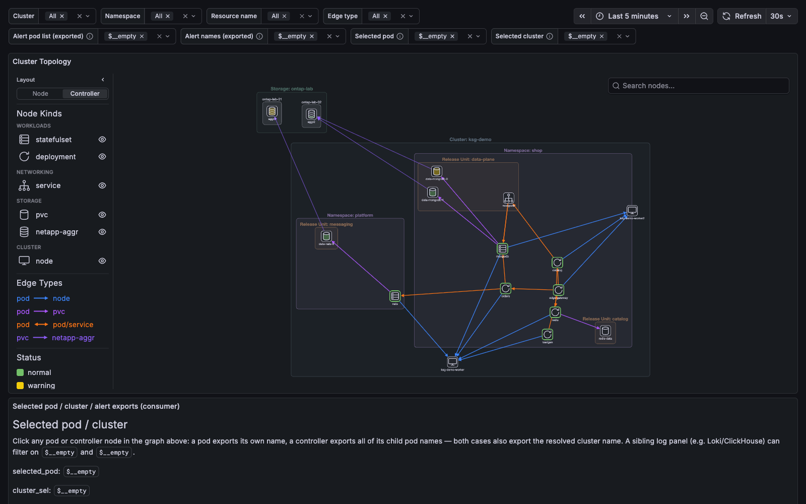

# kube-state-graph-demo

A complete, self-drawing demo of [`kube-state-graph`](https://github.com/akira-core/kube-state-graph)
and [`kube-state-graph-frontend`](https://github.com/akira-core/kube-state-graph-frontend)
on a local **kind** cluster.

One `make up` builds both projects from source, stands up the whole metrics
pipeline behind them, deploys a synthetic microservice estate that calls itself,
and hands you a standalone web UI drawing that estate as an interactive graph.
There is no Grafana: the front end is its own single-page application, served by
nginx, talking to the backend through its own origin.



```bash
make up          # ~5 minutes on a cold laptop
open http://localhost:3001      # the front door: /graph and /sankey (Storage)
```

Then:

```bash
make verify      # walk every hop of the pipeline and say which one is empty
make status      # pods across all three demo namespaces
make graph       # the raw /v1/graph JSON
make down        # delete the cluster
```

## What is real and what is not

kube-state-graph does not read the Kubernetes API. It builds the entire graph
from PromQL over a `[start, end]` window, which means a demo has to produce
*metrics*, not objects. Almost all of them here are produced by real components
doing real work:

| Real | Faked |
|---|---|
| Pods, Services, EndpointSlices, PVCs — actual Kubernetes objects on a 3-node kind cluster | The **NetApp ONTAP array**: aggregates, controllers, FlexVol topology and QoS I/O |
| kube-state-metrics, scraped by vmagent for the topology series the graph reads | |
| Real kubelet volume stats for claims on `netapp-nas` (CSI NFS `NodeGetVolumeStats`) | |
| Real HTTP calls between workloads, traced with OpenTelemetry | |
| The service-graph metrics, derived from those traces by the collector | |
| **vmalert** evaluating real alerting rules and persisting real `ALERTS` series | The readings those rules fire on — controller health, aggregate fill |
| kube-state-graph reading, joining and projecting all of it | Controller hardware (`model` / `serial` / `version`) and `system_node` load counters |

There is exactly one component whose data is invented — `netapp-faker` — because
a laptop cannot run an ONTAP array. Even that one **discovers rather than
fixtures**: every tick it asks the store holding the kube-state-metrics series
which claims exist on the demo StorageClass and renders a storage chain behind the `pvc-<uuid>` PV names
Kubernetes actually assigned. Create a PVC and its aggregate, controller and I/O
appear within one tick.

## The pipeline

```
 shop / platform namespaces          monitoring namespace
┌──────────────────────────┐   ┌───────────────────────────────────────────────┐
│ loadgen                  │   │                                               │
│   └→ edge-gateway ─┬→ catalog ──→ redis      OTLP traces                     │
│                    └→ orders ──┬→ mongodb        │                           │
│                                └→ nats           ▼                           │
│                                          ┌───────────────┐                   │
│  kube-state-metrics ──┐                  │ OTel Collector│                   │
│  kubelet          ──┐ │                  │  servicegraph │                   │
└─────────────────────┼─┼──┐               │  connector    │                   │
                      │ │  │               │  + cluster/az │  netapp-faker     │
                 scrape │  │               │    /env stamp │       │ import    │
                      ▼ ▼  │               └───────┬───────┘       │           │
              ┌───────────┐│                       │               │           │
              │  vmagent  ││                       ▼               ▼           │
              │ + stamp   ││          ┌──────────────────────────────────┐     │
              └─────┬─────┘│          │   store 1: VictoriaMetrics       │     │
                    ▼      │          │   cluster — vminsert → vmstorage │     │
        ┌──────────────────┴───┐      │             → vmselect           │     │
        │ store 2: vmsingle    │      │   harvest, servicegraph          │     │
        │ ksm, kubelet         │      └──────────────┬───────────────────┘     │
        └───────┬──────────────┘                     │                         │
                ▼ (basic auth)                       │                         │
        ┌───────────────┐                            │                         │
        │    vmauth     │◀── discovery ── netapp-faker                          │
        └───────┬───────┘                            │                         │
                │                        vmalert ────┤  rules in, ALERTS out    │
                │                       (blackhole)  │  — both ends store 1     │
                │           PromQL, routed by family │                         │
                └──────────────┬─────────────────────┘                         │
                      ┌────────▼─────────┐                                     │
                      │ kube-state-graph │  backends.yaml routing table        │
                      └────────┬─────────┘                                     │
                               │ /v1/graph (Cytoscape JSON)                    │
                      ┌────────▼─────────┐                                     │
                      │ kube-state-graph-frontend (nginx + SPA)                │
                      │   /api/          ─────────▶ kube-state-graph             │
                      │   /metrics-api/  ─────────▶ vmauth (credential attached  │
                      │                              in-cluster, never in the    │
                      │                              browser)                    │
                      └────────────────────────────────────────────────────────┘
```

### Two stores, one graph

The metrics live in **two** Prometheus-compatible installations, and
kube-state-graph assembles one graph from both. The split is by producer:

| Store | Query families | Written by | Read path |
|---|---|---|---|
| VictoriaMetrics **cluster** | `harvest`, `servicegraph`, `alerts` | netapp-faker (import), OTel Collector (remote-write), vmalert (rule results) | vmselect, unauthenticated |
| VictoriaMetrics **single** | `ksm`, `kubelet`, `appmeta` | vmagent | vmauth, basic auth |

The `probe` family (`up{}`) is served by both, so `/readyz` asks both stores
rather than calling the estate healthy on the strength of one.

`alerts` is the one **optional** family: a routing table omitting it still
loads and the backend answers an empty vector without warning, because an
estate running no alerting engine is that family's normal state. It is served
here so the overlay has something to overlay — the difference between "nothing
is firing" and "nobody is evaluating rules" is exactly what a demo has to be
able to show.

`appmeta` is the other optional family, and it is what turns on the backend's
**application-metadata metric** (`--app-metadata-metric`): one per-pod row naming
the pod's Application, its deployer and its namespace's owner. The demo adds no
producer for it — the metric is `kube_pod_labels`, so it rides the
kube-state-metrics pipeline that already exists:

- kube-state-metrics allowlists the metric and three pod labels
  (`pods=[argocd_app,user,owner]`), exported as `label_argocd_app`, `label_user`
  and `label_owner`; the backend's `appMetadata.labels` binds `app`, `user` and
  `ns_owner` to those spellings.
- vmagent stamps the row with the same `az` / `env` / `cluster` as the pod's other
  series — the one precondition the backend puts on the metric, and the reason it
  is served from the single-node store rather than the cluster one.
- Every pod carries its namespace's `owner`; only the four storefront workloads
  (`loadgen`, `edge-gateway`, `catalog`, `orders`) also carry `argocd_app` and
  `user`. The metric's Application **wins** over the controller-annotation chain
  for those pods, so the bare name it carries must equal what the tracking-id
  yields. `redis`, `mongodb` and `nats` carry no row and keep the controller
  chain, which is the control case — it is also what keeps `verify.sh` §10's
  "every drawn pod resolves an application" able to see a dropped allowlist.

The result is two fields that exist nowhere else in the body: `data.namespace_owner`
on namespace groups and `data.deployed_by` on application groups. **The SPA does
not render them yet** — they show only in the raw body (`make graph`), and
`verify.sh` §9 asserts them. Clearing `appMetadata.metric` in
`charts/ksg-demo/values.yaml` is a complete rollback (no query is issued, every
body is unchanged); naming it while no backend serves `appmeta` logs one Warn at
startup and behaves as unset.

This is not decoration. It puts the two halves of the storage join in different
stores — `kube_persistentvolumeclaim_info` in one, `volume_labels` in the
other — so **no PromQL can join them**. A `pvc-to-netapp-aggr` edge in the
rendered graph is therefore proof that the backend's fan-out and merge both
work, and `make wait` already gates on exactly that edge.

The single-node store also serves the Prometheus API under `/prometheus` where
the cluster build serves it under `/select/<accountID>/prometheus`, so the two
differ in shape and not only in name.

The routing table lives in `charts/ksg-demo/values.yaml` under
`kube-state-graph.backends`, is rendered into a ConfigMap, and is re-read every
30s without a restart. Removing it is a complete rollback to the single-upstream
deployment: `--prom-url` still points at the cluster store, and the backend
falls back to one implicit backend serving every family.

Every upstream query also passes a per-store guard that is **on by default**:
results are cached for 60s, concurrent identical queries are coalesced, at most
32 are in flight per store, and a graph request's `end` is floored to a 30s grid
(its `start` shifted equally). Two things follow when you debug here. A repaired
pipeline can take up to a cache TTL plus one grid step to show up in the graph —
a body describing "now" may be up to ~90s old. And a build served from the cache
asks neither store, so a per-build failure count of zero proves nothing about the
stores; `verify.sh` §8 builds over a window nothing else just read for that
reason. The demo leaves the defaults alone; `KSG_END_ALIGN=0`,
`KSG_QUERY_CACHE_MAX_SERIES=0` and `KSG_UPSTREAM_MAX_CONCURRENCY=0` in the
backend's `extraEnv` restore the raw behaviour.

Credentials are the one thing the routing file never carries. It names the
environment *variables* (`usernameEnv` / `passwordEnv`); a literal password in
the file is rejected, and a variable named there but unset is a load failure
rather than a quiet fallback to no credentials.

### Why the OpenTelemetry Collector is load-bearing

It does two jobs no other component can:

1. **Turns traces into service-graph metrics.** Its `servicegraph` connector
   pairs each CLIENT span with the SERVER span it caused and emits
   `traces_service_graph_request_*` carrying `client_k8s_pod_uid` /
   `server_k8s_pod_uid` — the only thing that lets the backend resolve a call
   edge to a *pod* rather than to an anonymous `external` node. The pod UID
   reaches the span via the downward API (`OTEL_RESOURCE_ATTRIBUTES`).
2. **Stamps `cluster`, `az` and `env` on them.** No exporter here emits these,
   yet every graph id is cluster-scoped as the composed identity
   `<az>-<env>-<cluster>` (the demo renders `local-a-demo-ksg-demo`) and the
   `?az=` / `?env=` / `?cluster=` request filters are pushed to upstream PromQL
   as raw label matchers. A family missing them does not error — it silently
   matches nothing, or composes a second identity if only the pair disagrees.

It scrapes **nothing**. The kube-state-metrics and kubelet jobs are vmagent's,
because the series they produce belong to the other store. vmagent stamps the
same three labels on what it collects, and both read them from one place —
`global.ksgExternalLabels` in `charts/ksg-demo/values.yaml` — because a value
that differed between the two would silently split the graph into two cluster
identities (or drop half of it out of any filtered request).

### Every edge type the backend can produce

The demo is arranged so that all six appear:

| Edge | Produced by |
|---|---|
| `pod-to-node` | every scheduled pod |
| `pod-mounts-pvc` | `mongodb`, `nats`, `redis` |
| `pod-calls-pod` | the HTTP call chain, with RED metrics |
| `pod-calls-service` | `catalog`'s connection-string peer (see below) |
| `service-selects-pod` | the fan-out from that Service to `mongodb-0/1` |
| `pvc-to-netapp-aggr` | the faked ONTAP estate |

`pod-calls-service` needs explaining, because it is not what you would guess.
Service nodes are materialised **on demand**, only for a Service some endpoint
actually named as a `://` connection string. So `catalog` emits a client span
with no server span and `peer.service =
mongodb://mongodb.shop.svc.cluster.local:27017`; the collector turns an
unmatched client span into a *virtual node* labelled with that attribute, and
the backend parses the host, classifies it as Kubernetes `.svc` DNS, and
resolves it to the real `mongodb` Service. `orders` still calls the mongodb
*pods* over HTTP, so the demo shows both shapes reaching the same backend.

### Deliberate negative cases

A demo where everything is green teaches nothing. These are on purpose:

- **`redis-data` is on the default StorageClass**, not `netapp-nas`. It gets a
  PVC node and no storage chain — which is how an operator tells "never meant to
  have a NetApp backend" apart from "should have joined and did not". The
  backend logs one `netapp_volume_join_miss` for it every build; that warning is
  the demo working, not failing.
- **`orders` answers 5% of requests with a 500**, so its edges carry a non-zero
  `errorRate`. An edge with `errorRate: 0` and an edge with no measurement at
  all must look different in the UI.
- **`ontap-lab-02` reports `node_new_status 0`.** Degraded is a real reading,
  distinct from the series being absent. vmalert turns it into a firing
  `NetAppControllerDegraded`, which the graph attaches to that controller node.
- **The two alerts fire on different controllers and different tiers.**
  `NetAppAggregateFilling` fires on `aggr1`, which the **healthy**
  `ontap-lab-01` owns. A degraded box is not the only thing worth an alert, and
  the overlay has to attach an aggregate alert to the aggregate rather than one
  tier up on its controller — the stock `aggr_*` series name both.
- **The two controllers are different hardware under different load.**
  `ontap-lab-01` is an AFF-A400 at 34% CPU; `ontap-lab-02` is an older FAS2720
  at 78% doing a third the ops at four times the latency. Those figures are
  carried through to `data.perf` raw and are never turned into a verdict —
  "busy" is not "unhealthy", and the pipeline must not decide otherwise.
- **Every node's border colour is one baked verdict, not a UI guess.** The
  backend folds alert severity, NetApp health and Kubernetes readiness into
  `data.status` (`normal` / `warning` / `critical`) at build time, so `/v1/graph`
  and `/v1/storage-graph` agree and the SPA only reads it. Performance
  deliberately does not participate. The demo populates all three bands: `aggr1`
  warns on a firing alert while its controller is healthy, `aggr2` and
  `ontap-lab-02` are critical on degraded health, and everything else is normal.
  `normal` means no negative signal was observed — not that every signal source
  answered.
- **`mongodb`'s Service is headless**, so its `cluster_ip` is `None` and it
  carries no ipaddress — again distinct from an unknown one.
- **Shared NFS export capacity.** `csi-driver-nfs` reports `statfs` of the
  in-cluster Ganesha export, so every claim on `netapp-nas` shows that
  export's size as `capacity_bytes`, not the claim's request. The demo
  proves the kubelet series exist and join; numeric per-claim fidelity is
  not what it demonstrates.

## Layout

```
charts/
  ksg-demo/          umbrella release: pins every upstream chart + the local ones
  kube-state-graph/  the API server
  kube-state-graph-frontend/  the front door: SPA config + nginx proxies
  netapp-faker/      the one fake component
  demo-workloads/    namespaces, StorageClass, workloads, Services, claims
  nfs-server/        in-cluster Ganesha export for csi-driver-nfs
docker/              two Dockerfiles: backend, demo tools. The front end is built
                     from the submodule's own Dockerfile — it ships a complete one
kind/cluster.yaml    3 nodes, zone labels, host port mappings
tools/               Go: the demo workload and the ONTAP faker
scripts/             wait-ready, verify, charts-deps, vendor-charts
kube-state-graph/           ── git submodule
kube-state-graph-frontend/  ── git submodule
```

### Chart dependencies are vendored, unpacked

The upstream charts are committed under `charts/ksg-demo/charts/` as plain
directories, not fetched at bring-up and not stored as `.tgz`:

```
charts/ksg-demo/charts/
  kube-state-metrics/        8.4.0      ── vendored, tracked
  opentelemetry-collector/   0.170.0    ── vendored, tracked
  victoria-metrics-cluster/  0.49.0     ── vendored, tracked   store 1
  victoria-metrics-single/   0.45.0     ── vendored, tracked   store 2
  victoria-metrics-agent/    0.46.0     ── vendored, tracked   scrapes into store 2
  victoria-metrics-auth/     0.40.0     ── vendored, tracked   store 2's read path
  victoria-metrics-alert/    0.47.0     ── vendored, tracked   ALERTS into store 1
  csi-driver-nfs/            4.13.4     ── vendored, tracked
  *.tgz                                 ── first-party charts, rebuilt by make deps
```

`helm dependency update` re-resolves every pin against its repo index, which
makes a disconnected `make up` fail before a single pod is scheduled — and it
also means the demo's meaning could shift under a moving index. So `make deps`
does not touch the network: it packages the first-party subcharts from
source and asserts the vendored ones are present *at the version
`Chart.lock` pins*. Helm does not re-check that for an unpacked subchart, so a
hand-edited or half-updated directory would otherwise install silently.

Unpacked rather than archived because a directory is reviewable: a version bump
arrives as a readable diff instead of an opaque binary blob, which for a repo
whose whole substance is wiring is the difference between a reviewable upgrade
and a leap of faith.

The first-party subcharts are deliberately *not* committed. They are the only
dependencies whose content changes between commits, and a checked-in copy would
be a second, staler source of truth — edit `demo-workloads/values.yaml`, forget
to repackage, and the install would quietly use the old one.

To move a pin, edit `charts/ksg-demo/Chart.yaml` and then, **online**:

```bash
make vendor-charts    # helm dependency update, unpack, then list what to commit
```

Commit the subchart directories together with `Chart.lock`; the two must move
as one or `make deps` reports the vendored set as stale.

Vendoring the charts is not by itself enough to bring the demo up on a
disconnected laptop — `kind create cluster`, the three `docker build`s (base
images, `go mod download`, `npm ci`) and the upstream container images all
still reach out. What it does buy is that
none of that happens at *Helm* time, and that a warm Docker cache is the only
other thing standing between a cold checkout and an offline bring-up.

Both first-party projects are **git submodules**, and every image is built from
them locally and side-loaded into kind with `kind load docker-image` — no
registry involved. To demo an unpushed local change, point the build at your own
working copy:

```bash
make redeploy-backend  BACKEND_SRC=../kube-state-graph
make redeploy-frontend FRONTEND_SRC=../kube-state-graph-frontend
make redeploy-workloads
```

Service names inside the cluster are pinned with `fullnameOverride` rather than
derived from the release name, because half of these components address each
other by URL in free-form config (the collector's remote-write endpoint, the
backend's `--prom-url`, the faker's two endpoints) and a URL cannot be templated
from inside a subchart's values.

## Entry points

| | URL | Notes |
|---|---|---|
| Front door | <http://localhost:3001> | the SPA, three standalone pages: `/graph` and `/sankey` (Storage) and `/network/sankey`, which is reachable but has no data source here. `/` redirects to `/graph` |
| Graph API | <http://localhost:18080/docs> | Scalar UI over the OpenAPI spec |
| VM cluster store | <http://localhost:18481/select/0/prometheus> | vmselect — Harvest and service-graph series, in raw PromQL |
| VM single store | <http://localhost:18427> | vmauth — kube-state-metrics and kubelet series. Needs `curl -u ksg:ksg-demo-not-a-real-secret` |

The front door is on **3001**, not the usual 3000, so this can run beside the
frontend repo's own `npm run dev`.

**There is no Grafana.** Ad-hoc PromQL goes straight to the stores — and you have
to ask the right one:

```bash
# cluster store: Harvest, service-graph
curl -sG http://localhost:18481/select/0/prometheus/api/v1/query --data-urlencode 'query=volume_labels'

# single-node store: kube-state-metrics, kubelet. Basic auth.
curl -sG -u ksg:ksg-demo-not-a-real-secret http://localhost:18427/api/v1/query \
  --data-urlencode 'query=kube_pod_info'
```

A query sent to the wrong store returns an empty result that looks exactly like a
broken pipeline, which is why every `verify.sh` section header names its store.

The front door's runtime configuration is authored in this repository, at
`charts/kube-state-graph-frontend/values.yaml`, and mounted as
`/srv/config/config.json`. It sets `demoMode: false` — `true` would render the
frontend's own bundled showcase fixture, a convincing graph that proves nothing
about the pipeline behind it.

The SPA is exactly **three standalone pages** — `/graph`, `/sankey` and
`/network/sankey` — and the nav bar links to none of them: it holds the
application name, the time range, the status indicator and the theme control. The
only in-app move between pages is the Storage Sankey's Locate into `/graph` (and
Back). Each page is a real URL, `/` redirects to `/graph`, `/network` to
`/network/sankey`, and each page carries its own scope in the query string (`?namespace=shop&prune=false` for the
graph, `?az=…&env=…&node=…&mode=write` for the Sankey, plus the shared
`?from=&to=` window). Neither page requests anything until **Query** is pressed:
the controls edit a draft, Query commits it to the URL and fetches, and while a
request is in flight the same button is **Cancel**. The URL is therefore the
*applied* scope — paste a link and the controls come back exactly as they were
drawn, waiting for one press of Query — which is what makes a bug report about
this demo actionable.

**The Network Sankey is present but dark here.** `/network/sankey` traces a
switch's traffic from a `GET /v1/trace`-style endpoint the SPA reads from
`endpoints.trace`. kube-state-graph serves no such route, so this demo's
`config.json` leaves the key out: the page fetches nothing, says "Trace endpoint
is not configured" before and after Query (its scope bar stays operable), and the
Storage pages are unaffected. Naming the key anyway would give it a Query that
always 404s; `verify.sh` §10 asserts the
config and the backend agree, in both directions, so a backend that starts
serving the route turns the check red instead of leaving a working view unwired.

Two consequences for the wiring here. The nginx history fallback
(`try_files $uri $uri/ /index.html`) is now the **only** way to reach a page other
than `/`, since the nav links nowhere: without it nginx looks for a file named
`sankey`, finds none, and answers 404 for every typed link, refresh and shared
URL. `verify.sh` §10 therefore requests all three paths directly — and
deliberately not `/network/graph`, which no longer exists but which the fallback
would still answer 200 for (the SPA's own not-found page). And a sole `az` /
`env` is seeded into the Sankey's draft on arrival: this estate has exactly one of
each, so the only thing left to choose before Query is a root.

Everything the browser fetches it fetches from **its own origin**, and nginx
forwards it in-cluster:

| Browser asks | Reaches | Why not direct |
|---|---|---|
| `/api/v1/graph`, `/api/v1/storage-graph` | `kube-state-graph:8080` | the backend would otherwise need a CORS policy naming this origin |
| `/metrics-api/api/v1/label/<name>/values` | `vm-auth:8427`, with the basic-auth header attached in-cluster | the credential must never reach a browser |

Both forward `GET` / `HEAD` only; `/api/metrics` (the backend's own registry) and
every `/metrics-api/` path outside label enumeration answer 404; and every
response carries the image's `security-headers.conf` (a `Content-Security-Policy`,
`X-Frame-Options: DENY`, `Referrer-Policy`, `nosniff`). None of that is inherited:
the chart's nginx Secret replaces the image's conf wholesale and restates each
rule, so `verify.sh` §10 asserts the policy header and both 404s to catch a Secret
that drifts from the image.

The filter bar sends what it collects straight to the backend. `cluster`, `az`,
`env` and `namespace` options are `kube_pod_info` label values from the
**single-node** store — that is the raw name, which is what `?cluster=` accepts.
`clusters[]` on the graph response is the composed identity `<az>-<env>-<cluster>`
(`local-a-demo-ksg-demo` here) and is **not** a valid `?cluster=` value.
There is no edge-type control. The backend withdrew `/v1/edge-types` and
`?edge_type=` together, and it ignores unknown parameters rather than rejecting
them — so a control still sending one would populate, accept a selection and
narrow nothing, answering 200 either way. Filter on each edge's `data.type`,
which every edge has always carried. `Projection` is the backend's `?prune=`:
**Traffic graph** (the default) draws only workload sitting on a connectivity
edge, **Full inventory** draws every loaded pod plus the infrastructure nothing
references — which is what `make verify` asserts against, so the two agree only
in that position.

The time picker in the nav bar is the request window: the backend requires an
absolute `start` and `end` on every call, and the front end resolves the
selection at request time so a reload never re-asks for a stale window.

### The Sankey view

The second **page** is a different question against a different endpoint. `/v1/graph`
is workload-rooted; `/v1/storage-graph` is a **storage-flow DAG** oriented
storage → workload, along one fixed tier chain:

```
netapp-node → netapp-aggr → netapp-svm → pvc → pod → node
```

Every hop carries the claim I/O summed over everything flowing through it, and
the totals **conserve tier to tier** — that is what makes the link widths mean
something, and `verify.sh` asserts it by comparing the top hop's figures against
the claim hop's for all four (`read_ops`, `write_ops`, `read_bytes_per_sec`,
`write_bytes_per_sec`): the `Weight` control (`Throughput` | `IOPS`, a `weight=`
URL parameter, `Throughput` omitted) and the `Mode` control pick among exactly
those. Two things about this endpoint differ from `/v1/graph` and both are
visible in the UI:

- **`az` and `env` are REQUIRED.** They pin the zone whose Harvest store is
  asked and narrow the workload side to one estate, so a filer shared across
  zones is never merged into one diagram. The backend now accepts several of each
  (the body is the union of the single-zone bodies) but the Sankey still sends
  one of each, and `verify.sh` §10 sends a repeated `az` only as backend
  contract. The Sankey's scope bar is its own control, not the graph's filter
  bar, and it takes its options from the same `kube_pod_info` label values.
- **Exactly ONE root kind is required, and roots may come from either end.** No
  root is `400 missing_root`, two kinds is `400 invalid_scope`, and the page
  never sends either: adding a root replaces the roots of every other kind, and a
  link naming two keeps both in the draft with Query off and the reason beside
  it. An ONTAP cluster (`ontap_cluster`), controller (`ontap_node`), aggregate
  (`aggr`) or SVM (`svm`) answers "what is on this filer?"; a `namespace/pod` or
  a Kubernetes `node` answers "which controller does this pod sit on?". **`node`
  names a Kubernetes node only** — a controller name sent as `node=` is an empty
  200, which is why the controller kind is its own. Only the workload-side kinds
  can be enumerated: `node` from `kube_pod_info`, `pod` from the selected
  namespace. ONTAP cluster, controller, aggregate and SVM are typed until a
  query has drawn them. Adding all three Kubernetes nodes draws the whole
  estate here, and is the request `verify.sh` §10 makes; it then roots on each
  controller in turn and asserts the contract above. The backend also takes
  `pvc=`, `pv=` and `application=` roots, which the Sankey does not offer yet;
  §10 exercises `pvc=` and `application=` as backend contract.
- **An upstream error is a `502`, never a smaller diagram.** The storage build
  fails on any query error except the alert overlay, and the page shows the
  backend's message (`upstream query failed: <family>`) in its error state.
- **`Top pods` (default 10) is a client-side cut.** It keeps the pods with the
  highest flow in the current mode and anything upstream still on a path to
  one; it is never sent to the backend, and it is off while a `pod` root is
  present. This estate has three claim-carrying pods, so the cut never engages
  here — on a bigger one, a diagram of exactly ten pods is the cut, and the
  summary says how many are hidden.

`netapp-svm` and the `storage-flow` edge type are emitted by this endpoint
**only** — `/v1/graph` still surfaces the SVM as the PVC's `svm` label and never
draws a storage-flow edge.

**What the view draws is not that tier chain one-for-one.** The diagram ends at
the *namespace*, not at the Kubernetes node, in seven columns:

```
netapp-node → netapp-aggr → netapp-svm → pvc → pod → application → namespace
```

The first five are backend tiers, drawn at the weights the endpoint returns. The
last two are **derived**: the backend deliberately emits no edge above the pod, so
the view walks each drawn pod's `data.parent` chain up to the `application` and
`namespace` compound nodes the same response already carries, and sums that pod's
conserved `pvc-pod` weight onto them. It is the only client-side arithmetic in the
view, it never writes back into a backend tier, and what it produces is marked
"derived from member pods" in tooltips and in the summary tables.

Those compounds are not free. They are here only because kube-state-metrics
collects the owning controller kind **and** allowlists the ArgoCD tracking-id
annotation on it — the same wiring that gives the graph view its application
nesting. Trim either and `/v1/storage-graph` still answers 200 with all five tiers
present, and the diagram quietly loses its two right-hand columns: it reads as an
estate that groups nothing rather than as a trimmed allowlist. `make verify` §10
asserts every drawn pod still reaches both.

The Kubernetes node did not disappear, it changed job. As a column its ribbons
only restated the `pvc-pod` weights of the pods sitting on it, so the diagram read
as if the flow continued past the pod. It is now the **Layout** control: `Flat`
draws pods loose, `Node` wraps each pod in the node it runs on — ordered by name,
because a node is an inventory item you look up rather than rank by throughput,
and ordering by flow would move one on every refresh. That choice is
page-transient: unlike the scope pills and `Weight` beside it, it is not a URL parameter and
does not survive a reload. `pod-node` is therefore still a required tier — losing
it empties that control rather than putting a gap in the diagram.

The **SVM** control answers a question the tier chain cannot. `aggr → svm → pvc`
sums the per-claim aggregate away at the SVM, and this estate's one SVM,
`svm_demo`, holds claims on *both* aggregates — so under `Column` (the default)
nothing on the diagram says which aggregate a claim is actually on. `Group`
removes the SVM column, wraps each SVM's claims in a frame in the PVC column, and
runs a ribbon straight from each claim's own aggregate to it. It reads that
aggregate from the PVC's `labels.aggr`, the id of a `netapp-aggr` node in the
same body, which the backend stamps from the same pick that draws the claim's
`pvc-to-netapp-aggr` edge. A body with no such label presents `Group` disabled
while `Column` keeps drawing, so `make verify` §10 asserts every claim names an
aggregate the body holds, and that the claims span more than one. Like `Layout`,
the choice is page-transient.

## Troubleshooting

Start with `make verify`. Nearly every failure mode in this pipeline is silent —
a missing label does not error, it just removes edges — so the script asserts
each precondition in the order the data flows and names what breaks when it is
missing:

```
== 7. the split is real, and the join spans it ==
   ok   the derived volume key joins a real PV         3 claims match a FlexVol name
   ok   cluster store holds no kube_pod_info           0 series
   ok   single store holds no volume_labels            0 series
   ok   vmauth rejects an unauthenticated read         HTTP 401

== 8. upstream backend routing ==
   ok   routing table has both backends                kube_state_graph_upstream_backends = 2
   ok   backend cluster-store failures during one build 0 new (15 lifetime)
   ok   backend single-store failures during one build 0 new (38 lifetime)
   ok   /readyz — every backend answered               HTTP 200
```

Because the demo now spans two stores, every check names the one it asks: a
query sent to the wrong store returns an empty result that looks exactly like a
broken pipeline. The per-backend failure counters are read as a **delta across
one graph build** rather than as absolutes — they are cumulative since process
start, and a cold bring-up reliably puts tens of connection-refused errors in
them because the server is ready before either store is.

The graph is also empty for a mundane reason for the first minute or so: the
backend builds over the requested window, and nothing has been scraped yet.
`make wait` (part of `make up`) blocks until the front door answers `/healthz`
and until a `pvc-to-netapp-aggr` edge exists — the longest chain in the demo,
and therefore the last thing to appear.

| Symptom | Look at |
|---|---|
| Front door loads but the graph is blank with an error | the `/api/` proxy is not reaching the backend — `kubectl -n monitoring logs deployment/kube-state-graph-frontend` |
| Front door shows a graph with no live data behind it | `demoMode` is `true` in the served `/config.json`; the SPA is drawing its own bundled fixture |
| Graph has pods but no call edges | `make logs-collector`; check `client_k8s_pod_uid` in `make verify` |
| Call edges end in `external` nodes | the pod UID is not reaching the spans — check `OTEL_RESOURCE_ATTRIBUTES` on a workload |
| No pods or nodes at all | `kubectl logs deployment/vm-agent` — nothing is scraping into the single-node store |
| No storage half at all | `make logs-faker`; the join derives a token from `kube_persistentvolumeclaim_info.volumename` (`-` → `_`) and suffix-matches it against the stock Harvest `volume` label, and nothing else — its two halves are in different stores |
| Edges have no `p90ServerMs` | the collector's `transform/servicegraph-names` — with metric suffixes off, the histogram loses its `_seconds` and must have it put back |
| `/readyz` is 503 naming a backend | that store is down or unreachable; the body names the backend, never its URL |
| Graph or Sankey stays empty after opening a link or a refresh | expected: neither page requests anything until **Query** is pressed — the link has only prefilled the controls |
| Sankey shows its empty state and Query is unavailable | `endpoints.storageGraph` is absent from `config.json`, or the draft lacks `az`, `env` or a root — all three are required, and the root is exactly ONE kind (a link naming two keeps both and says so beside Query); the empty state names which |
| Sankey's error state reads `upstream query failed: <family>` | the storage build fails closed on any upstream query error except the alert overlay, so a Harvest or kubelet outage is a `502`, not a thin diagram. Find the store with `make verify` §8 and `make logs-backend` |
| A controller name as `node=` draws nothing | expected: `node=` is a Kubernetes node only, so that is an empty 200. A controller is `ontap_node=` |
| Sankey draws with a gap between two tiers | one leg of the chain is empty; `make verify` §10 names which tier has no edges |
| Sankey stops at the Pod column — no Application / Namespace | the derived columns found no compound to walk to: kube-state-metrics has lost either the owning controller collector or the `argocd.argoproj.io/tracking-id` entry in `metricAnnotationsAllowList`. `make verify` §10 counts how many drawn pods resolve both |
| Sankey's `Layout` → `Node` groups nothing | the `pod-node` tier is empty — that is the kubelet leg; `make verify` §10 names it |
| Sankey's `SVM` → `Group` is disabled | the storage graph's PVCs carry no `labels.aggr` — the backend image predates `expose-claim-aggregate`; `make redeploy-backend`. `make verify` §10 counts the claims that name their aggregate |
| The Network Sankey says the trace endpoint is not configured | expected: kube-state-graph serves no `/v1/trace`, so `endpoints.trace` is deliberately absent. `make verify` §10 fails if the backend starts serving the route |
| `/network/graph` shows a not-found page | expected: the Network Graph page was removed; the SPA has three pages and `/network` redirects to `/network/sankey`. The front door still answers 200 for the path (the history fallback), so only the page says so |
| No `data.namespace_owner` / `data.deployed_by` in the graph | the application-metadata metric is off or unrouted: `make verify` §9 names which. Check that `appmeta` is in `kube-state-graph.backends`, that `appMetadata.metric` is set, that kube-state-metrics exports `kube_pod_labels` with `label_argocd_app` / `label_user` / `label_owner` (`curl -u … :18427/api/v1/query?query=kube_pod_labels`), and `make logs-backend` for the startup Warn |
| A pod shows the wrong Application after the metric was added | the metric's `argocd_app` wins over the controller chain and is used verbatim; it must equal the bare name in the tracking-id (`storefront`, not `storefront:/Deployment:…`) |
| No node carries `data.alerts` | `kubectl logs deployment/vmalert`; the `alerts` family must also be routed in `kube-state-graph.backends`, and ALERTS must carry `az`/`env` (it inherits them from the expression output) |
| `data.alerts` is in the API body but the UI shows no alert | fixed in frontend `002b975`; on an older SPA image `parseAlerts` required the panel-era occurrence time and dropped every entry without one. The overlay's alerts carry no time, so the panel shows `n/a` in Count and Last occurred — that is the degraded form, not a missing reading |
| A controller shows no model or CPU figure | the `node_labels` / `system_node` legs are optional and degrade silently — check `make verify` §6 |
| Everything filtered by `?az=` is empty | vmagent's `external_labels` and the collector's `transform/external-labels` disagree — both must come from `global.ksgExternalLabels` |
| Graph ids / cluster compound read `local-a-demo-ksg-demo` | expected: that is the composed identity `<az>-<env>-<cluster>` |
| `?cluster=local-a-demo-ksg-demo` is empty | expected: `?cluster=` takes the raw name `ksg-demo`; pin with `?az=local-a&env=demo&cluster=ksg-demo` |
| Cluster / AZ / Env / Namespace controls are empty | the `/metrics-api/` proxy is not reaching vmauth, or the `Authorization` header it attaches is wrong — check `global.ksgUpstreamAuth` and the front end's nginx Secret |
| SPA console warns `unknown endpoint key: edgeTypes` | `charts/ksg-demo/values.yaml` still carries `endpoints.edgeTypes`; the catalogue was withdrawn — drop the key |
| Backend logs "upstream backends did not answer" right after `make up` | expected: the server is ready before either store is, and it retries |

## Requirements

`docker`, `kind`, `kubectl`, `helm` (v3 or v4), `jq`, `curl`, and `git`. Go and
Node are **not** required on the host — both builds run inside Docker.
